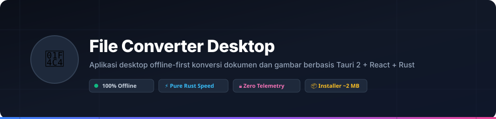
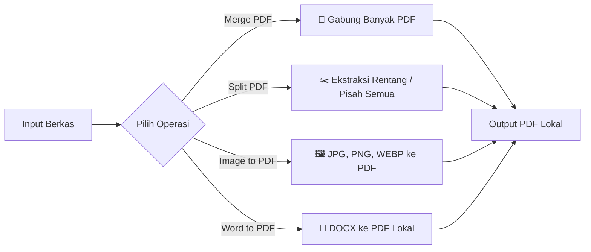
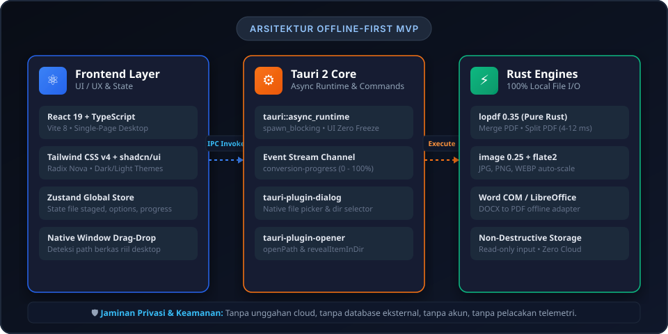
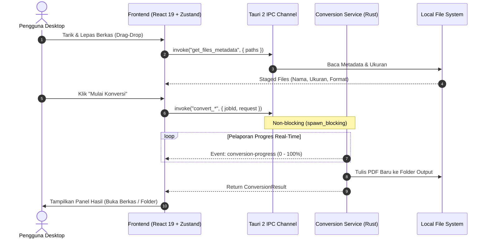

<div align="center">



# File Converter Desktop

**Aplikasi Desktop Offline-First untuk Konversi Dokumen & Gambar Berkecepatan Tinggi**  
*Dibangun dengan Tauri 2 + React 19 + TypeScript + Tailwind CSS v4 + Rust*

[](07-RELEASE_NOTES.md)
[](07-RELEASE_NOTES.md)
[](LICENSE)
[](06-TEST_REPORT.md)
[](README.md#prinsip-keamanan--privasi)

</div>

---

## 📖 Daftar Isi

- [Tentang Aplikasi](#-tentang-aplikasi)
- [Prinsip Keamanan & Privasi](#-prinsip-keamanan--privasi)
- [Fitur Utama (P0 MVP)](#-fitur-utama-p0-mvp)
- [Arsitektur Sistem](#-arsitektur-sistem)
- [Struktur Direktori Project](#-struktur-direktori-project)
- [Panduan Instalasi & Download](#-panduan-instalasi--download)
- [Panduan Pengembangan (Development)](#-panduan-pengembangan-development)
- [Hasil Pengujian & Benchmark](#-hasil-pengujian--benchmark)
- [Dokumentasi Lengkap](#-dokumentasi-lengkap)

---

## 💡 Tentang Aplikasi

**File Converter Desktop** adalah solusi modern untuk kebutuhan konversi dokumen sehari-hari tanpa mengorbankan privasi berkas pribadi atau perusahaan Anda. 

Berbeda dengan layanan konverter daring (*web converters*) yang mewajibkan pengunggahan dokumen sensitif ke server asing:
- **100% Pemrosesan Lokal:** Seluruh penggabungan, pemotongan, dan konversi berkas diproses langsung oleh CPU dan RAM komputer Anda.
- **Ukuran Sangat Ringan:** Menggunakan WebView2 native Windows berukuran installer hanya **~2.0 MB** (jauh lebih ringan dibanding aplikasi berbasis Electron yang umumnya berukuran 100–150 MB).
- **Performa Ekstrem Pure Rust:** Pemrosesan berkas PDF dan decoding gambar dijalankan oleh mesin native Rust (`lopdf`, `image`) yang selesai dalam hitungan **milidetik** (4–30 ms).

---

## 🛡️ Prinsip Keamanan & Privasi

1. **Zero Cloud Uploads:** Aplikasi sama sekali tidak memiliki fungsi pengunggahan jaringan. Dokumen tidak pernah meninggalkan perangkat Anda.
2. **Zero Telemetry:** Tidak ada pelacak perilaku (*analytics*), *crash reporters* pihak ketiga, atau cookies.
3. **Non-Destructive File I/O:** Berkas input asli selalu dibuka dalam mode *shared read-only*. Sistem tidak akan pernah mengubah atau menghapus dokumen asli.
4. **Tanpa Akun & Tanpa Langganan:** Langsung pakai tanpa perlu mendaftar, memasukkan email, atau membayar biaya langganan bulanan.

---

## ⚡ Fitur Utama (P0 MVP)



### 1. Merge PDF (Penggabungan PDF)
- Menggabungkan 2 atau lebih berkas PDF menjadi satu dokumen PDF yang rapi.
- Dukungan drag & drop urutan berkas (*reordering*).
- Penanganan cerdas trailer lopdf dan penomoran ulang objek (*XRef collision-free*).
- Kecepatan pemrosesan: **~9–12 ms** untuk penggabungan dokumen.

### 2. Split PDF (Pemotongan PDF)
- **Ekstraksi Rentang Halaman:** Pilih rentang fleksibel sesuai kebutuhan (contoh: `1-3, 5, 8-10`).
- **Pisah Semua Halaman:** Otomatis membagi setiap halaman menjadi berkas PDF terpisah (`split_page_1.pdf`, `split_page_2.pdf`, dst).
- Validasi instan untuk nomor halaman di luar batas dokumen (*out of bounds*).

### 3. Image to PDF (Gambar ke PDF)
- Mendukung format gambar **JPEG (.jpg, .jpeg)**, **PNG (.png)**, dan **WEBP (.webp)**.
- **Auto-Fit & Centering:** Gambar secara otomatis diskalakan proporsional agar pas dalam batas margin tanpa terpotong atau terdistorsi.
- Pilihan orientasi: *Auto*, *Portrait*, *Landscape*.
- Pilihan margin halaman: *None (0pt)*, *Small (18pt)*, *Normal (36pt)*.

### 4. Word to PDF (DOCX ke PDF)
- Mengonversi dokumen Word (`.docx`) ke PDF dengan presisi layout, tabel, font, dan diagram 100%.
- Menggunakan adapter otomatis:
  - **Microsoft Word COM Automation:** Tersedia secara native di Windows yang terpasang Office.
  - **LibreOffice CLI Headless:** Fallback open-source tanpa perlu Microsoft Office.
- Pilihan otomatis membuka berkas PDF hasil konversi setelah proses selesai.

---

## 🏗️ Arsitektur Sistem



Arsitektur aplikasi memisahkan secara tegas batas tanggung jawab antara UI State (React) dengan Kernel I/O (Rust):



---

## 📁 Struktur Direktori Project

Project ini terstruktur secara modular dan rapi:

```text
D:\Konverter\
│
├── assets/                       # Asset visual, diagram, dan banner README
│   ├── app-logo.png
│   ├── architecture-diagram.svg
│   └── banner.svg
│
├── converter-desktop/            # APLIKASI DESKTOP UTAMA (Tauri + React)
│   ├── src/                      # Frontend Application (React 19 + TS)
│   │   ├── components/           # Komponen UI (Dropzone, FileList, Panels)
│   │   ├── features/             # Halaman: Dashboard, Workspace, Settings
│   │   ├── services/             # Tauri IPC Client (tauriConversionService.ts)
│   │   ├── stores/               # State Management Zustand
│   │   └── types/                # Kontrak Data & Definisi TypeScript
│   │
│   ├── src-tauri/                # Backend Desktop (Rust 2024 Edition)
│   │   ├── src/
│   │   │   ├── commands/         # Tauri Command Handlers (convert.rs, system.rs)
│   │   │   ├── converters/       # Core Engine (pdf_merge, pdf_split, image_to_pdf, docx_to_pdf)
│   │   │   ├── errors/           # Pemetaan Error Type Ramah Pengguna
│   │   │   ├── models/           # Data Transfer Objects (Serde camelCase)
│   │   │   ├── services/         # Orkestrasi & Event Streaming
│   │   │   └── lib.rs            # Builder Tauri & Suite 15 Unit Tests
│   │   ├── Cargo.toml            # Dependensi Rust (lopdf, image, flate2, tauri)
│   │   └── tauri.conf.json       # Konfigurasi Jendela, Ukuran & Bundle Windows
│   │
│   └── package.json              # Vite, React, Tailwind CSS v4, shadcn/ui
│
├── poc-converters/               # Proof of Concept & Fixtures Validasi Engine
│   ├── fixtures/                 # Berkas uji nyata (sample.docx, sample1.pdf, sample.png, dll)
│   └── src/bin/                  # 4 Biner uji awal sebelum integrasi
│
├── 01-PRODUCT_BRIEF.md           # Product Brief Awal
├── 02-PRD_AND_PLAYBOOK.md        # PRD & Panduan Eksekusi 10 Fase
├── 03-TECHNICAL_PLANNING_GUIDE.md # Panduan Tahap Perencanaan Teknis
├── 04-TECHNICAL_PLAN.md          # Dokumen Arsitektur & IPC Contract
├── 04-TECHNICAL_PLAN_SPEC.md     # Spesifikasi Teknis Mendalam
├── 05-POC_VALIDATION_REPORT.md   # Laporan Validasi 4 Mesin Konversi
├── 06-TEST_REPORT.md             # Laporan Pengujian 15 Skenario Uji Stabilitas
├── 07-RELEASE_NOTES.md           # Catatan Rilis Versi 1.0.0
└── README.md                     # Dokumentasi Utama Project Ini
```

---

## 📥 Panduan Instalasi & Download

Anda dapat langsung memasang atau menjalankan aplikasi versi rilis:

| Tipe File | Lokasi Berkas | Penggunaan |
|---|---|---|
| **Installer Setup (.exe)** | [`File Converter Desktop_1.0.0_x64-setup.exe`](converter-desktop/src-tauri/target/release/bundle/nsis/File%20Converter%20Desktop_1.0.0_x64-setup.exe) | Pasang ke sistem Windows dengan icon Start Menu & Desktop |
| **Paket MSI (.msi)** | [`File Converter Desktop_1.0.0_x64_en-US.msi`](converter-desktop/src-tauri/target/release/bundle/msi/File%20Converter%20Desktop_1.0.0_x64_en-US.msi) | Instalasi MSI standar Windows |
| **Portable (.exe)** | [`converter-desktop.exe`](converter-desktop/src-tauri/target/release/converter-desktop.exe) | Langsung jalankan tanpa proses instalasi |

> [!TIP]
> **Catatan Windows SmartScreen:** Karena versi ini belum dipasangi sertifikat berbayar (*code-signing*), jika muncul notifikasi layar biru Windows Defender:
> 1. Klik **"More info"** (*Informasi selengkapnya*).
> 2. Klik **"Run anyway"** (*Tetap jalankan*).

---

## 🛠️ Panduan Pengembangan (Development)

### Prasyarat
- **Node.js** (v18 ke atas) & **npm**
- **Rust & Cargo** (v1.85+ stable MSVC)
- **C++ Build Tools** (Visual Studio 2022 C++ x64/x86 Build Tools)

### 1. Menjalankan Mode Development (Live Reload)

Jika menggunakan **Command Prompt (CMD)**:
```cmd
cd D:\Konverter\converter-desktop
set PATH=%USERPROFILE%\.cargo\bin;%PATH%
npm run tauri dev
```

Jika menggunakan **PowerShell**:
```powershell
cd D:\Konverter\converter-desktop
$env:PATH = "$env:USERPROFILE\.cargo\bin;$env:PATH"
npm run tauri dev
```

### 2. Menjalankan Unit Tests Backend (15 Skenario)

```powershell
cd D:\Konverter\converter-desktop\src-tauri
& "$env:USERPROFILE\.cargo\bin\cargo.exe" test
```

### 3. Membangun Installer Rilis Mandiri

```cmd
cd D:\Konverter\converter-desktop
set PATH=%USERPROFILE%\.cargo\bin;%PATH%
npm run tauri build
```

---

## 📊 Hasil Pengujian & Benchmark

Seluruh fitur telah diverifikasi melalui pengujian otomatis pada [`06-TEST_REPORT.md`](06-TEST_REPORT.md):

| Fitur / Skenario | Waktu Rata-rata | Status |
|---|---|:---:|
| **Merge PDF (4 Halaman)** | **12 ms** | ✅ Lulus |
| **Split PDF (Rentang Spesifik)** | **4 ms** | ✅ Lulus |
| **Split PDF (Semua Halaman)** | **8 ms** | ✅ Lulus |
| **Image to PDF (PNG + JPG)** | **32 ms** | ✅ Lulus |
| **Word to PDF (DOCX Asli)** | **1.5 detik** | ✅ Lulus |
| **Proteksi Berkas Rusak & 0-Byte** | Ditangani tanpa panic | ✅ Lulus |
| **Integritas Berkas Asli (SHA-256)** | Terbukti tidak berubah (*read-only*) | ✅ Lulus |
| **Stabilitas Eksekusi Berulang (5x)** | Waktu konstan, 0 memory leak | ✅ Lulus |

---

## 📚 Dokumentasi Lengkap

Untuk mempelajari detail perancangan teknis dan laporan tiap tahapan, silakan baca dokumen berikut:

### 📁 v1.0 — MVP (Selesai)
- [`01-PRODUCT_BRIEF.md`](docs/v1.0-mvp/01-PRODUCT_BRIEF.md): Visi awal produk dan batasan ruang lingkup.
- [`02-PRD_AND_PLAYBOOK.md`](docs/v1.0-mvp/02-PRD_AND_PLAYBOOK.md): Panduan utama PRD dan metodologi playbook 10 fase.
- [`03-TECHNICAL_PLANNING_GUIDE.md`](docs/v1.0-mvp/03-TECHNICAL_PLANNING_GUIDE.md): Pedoman teknis sebelum implementasi.
- [`04-TECHNICAL_PLAN.md`](docs/v1.0-mvp/04-TECHNICAL_PLAN.md): Rencana arsitektur teknis, IPC contracts, dan pemilihan engine.
- [`05-POC_VALIDATION_REPORT.md`](docs/v1.0-mvp/05-POC_VALIDATION_REPORT.md): Laporan validasi PoC konversi engine.
- [`06-TEST_REPORT.md`](docs/v1.0-mvp/06-TEST_REPORT.md): Laporan pengujian kualitas dan keandalan 15 skenario.
- [`07-RELEASE_NOTES.md`](docs/v1.0-mvp/07-RELEASE_NOTES.md): Catatan rilis v1.0.0 dan panduan pengguna.

### 📁 v1.1 — Expansion (Sedang Berjalan)
- [`01-RINGKASAN_PROJECT.md`](docs/v1.1-expansion/01-RINGKASAN_PROJECT.md): Ringkasan eksekutif project dengan roadmap 19 fitur.
- [`02-PRD_AND_PLAYBOOK.md`](docs/v1.1-expansion/02-PRD_AND_PLAYBOOK.md): PRD & playbook 14 fase untuk 15 fitur baru.

---

<div align="center">
  <b>File Converter Desktop</b> — 100% Offline, Cepat, dan Menghormati Privasi Anda.
</div>

