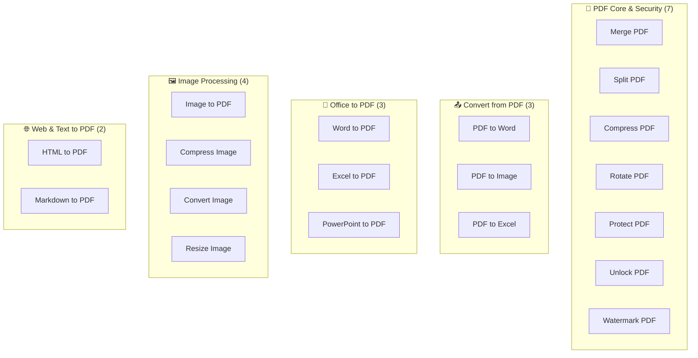
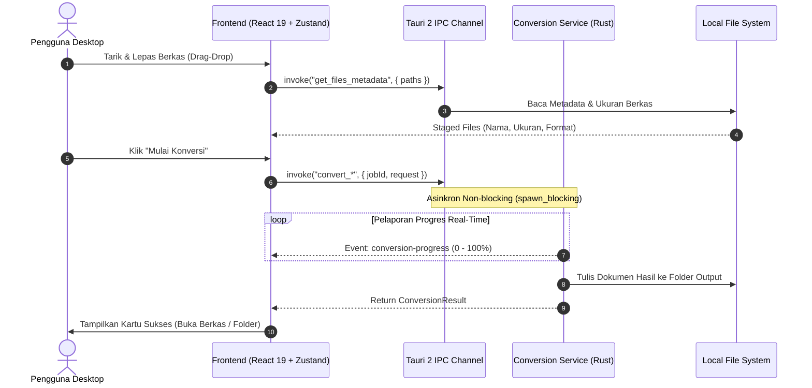

<div align="center">


# File Converter Desktop

**Aplikasi Desktop Offline-First untuk Konversi Dokumen & Gambar Berkecepatan Tinggi**  
*Dibangun dengan Tauri 2 + React 19 + TypeScript + Tailwind CSS v4 + Rust*

[](docs/v1.1-expansion/04-RELEASE_NOTES.md)
[](docs/v1.1-expansion/04-RELEASE_NOTES.md)
[](LICENSE)
[](docs/v1.1-expansion/03-TEST_REPORT.md)
[](README.md#-prinsip-keamanan--privasi)

</div>

---

## 📖 Daftar Isi

- [Tentang Aplikasi](#-tentang-aplikasi)
- [Prinsip Keamanan & Privasi](#-prinsip-keamanan--privasi)
- [Seluruh 19 Fitur Konversi & Utilitas](#-seluruh-19-fitur-konversi--utilitas)
- [Arsitektur Sistem](#-arsitektur-sistem)
- [Struktur Direktori Project](#-struktur-direktori-project)
- [Panduan Instalasi & Download](#-panduan-instalasi--download)
- [Panduan Pengembangan (Development)](#-panduan-pengembangan-development)
- [Hasil Pengujian & Benchmark](#-hasil-pengujian--benchmark)
- [Dokumentasi Lengkap](#-dokumentasi-lengkap)

---

## 💡 Tentang Aplikasi

**File Converter Desktop** adalah solusi modern dan berkecepatan tinggi untuk kebutuhan konversi dokumen, lembar kerja, presentasi, dan gambar sehari-hari tanpa mengorbankan privasi berkas pribadi atau perusahaan Anda. 

Berbeda dengan layanan konverter daring (*web converters*) yang mewajibkan pengunggahan dokumen sensitif ke server asing:
- **100% Pemrosesan Lokal:** Seluruh penggabungan, pemotongan, enkripsi, dan konversi berkas diproses langsung oleh CPU dan RAM komputer Anda.
- **Ukuran Sangat Ringan:** Menggunakan WebView2 native Windows berukuran installer hanya **~2.8 MB** (jauh lebih hemat penyimpanan dibanding aplikasi berbasis Electron yang umumnya berukuran 100–150 MB).
- **Performa Ekstrem Pure Rust:** 14 dari 19 tool dijalankan oleh mesin native Rust (`lopdf`, `image`, `docx-rs`, `rust_xlsxwriter`, `pdf-render`, `pulldown-cmark`) yang selesai dalam hitungan **milidetik** (6–120 ms).

---

## 🛡️ Prinsip Keamanan & Privasi

1. **Zero Cloud Uploads:** Aplikasi sama sekali tidak memiliki fungsi pengunggahan jaringan. Dokumen tidak pernah meninggalkan perangkat Anda.
2. **Zero Telemetry:** Tidak ada pelacak perilaku (*analytics*), *crash reporters* pihak ketiga, cookies, atau koneksi latar belakang.
3. **Non-Destructive File I/O:** Berkas input asli selalu dibuka dalam mode *shared read-only*. Sistem tidak akan pernah mengubah atau menghapus dokumen asli.
4. **Tanpa Akun & Tanpa Langganan:** Langsung pakai tanpa perlu mendaftar, memasukkan email, atau membayar biaya langganan bulanan.

---

## ⚡ Seluruh 19 Fitur Konversi & Utilitas



### 1. PDF Core & Manipulasi
- **Merge PDF:** Menggabungkan banyak berkas PDF dengan fitur penataan urutan drag & drop.
- **Split PDF:** Memotong PDF dengan mode rentang halaman tertentu (misal: `1-3, 5`) atau memisahkan setiap halaman menjadi satu file terpisah.
- **Compress PDF:** Mengompresi stream objek dan gambar internal dokumen PDF (Low, Medium, High).
- **Rotate PDF:** Memutar halaman PDF (90°, 180°, 270°) untuk seluruh atau halaman tertentu.
- **Protect PDF:** Mengamankan PDF dengan enkripsi password (RC4 128-bit).
- **Unlock PDF:** Membuka dan menghapus enkripsi password dokumen PDF yang terproteksi.
- **Watermark PDF:** Menyematkan cap air teks dengan kustomisasi font, ukuran, rotasi diagonal, warna, dan transparansi.

### 2. Konversi dari PDF
- **PDF to Word (.docx):** Ekstraksi teks & tata letak PDF ke dokumen Word Open XML.
- **PDF to Image (.png / .jpg):** Render halaman PDF ke gambar tajam dengan pilihan 150 / 300 DPI.
- **PDF to Excel (.xlsx):** Ekstraksi kisi tabel PDF ke lembar kerja spreadsheet Excel.

### 3. Dokumen Kantor ke PDF
- **Word to PDF (.docx):** Konversi dokumen Word ke PDF via Word COM Automation atau LibreOffice headless.
- **Excel to PDF (.xlsx / .csv):** Render tabel spreadsheet Excel atau data CSV ke PDF rapi.
- **PowerPoint to PDF (.pptx):** Konversi presentasi PowerPoint ke PDF via PowerPoint COM atau LibreOffice.

### 4. Alat Gambar (Image Tools)
- **Image to PDF:** Konversi kumpulan gambar JPG, PNG, WebP ke dokumen PDF proporsional.
- **Compress Image:** Mengurangi ukuran gambar JPEG/PNG dengan quality tuning lokal.
- **Convert Image:** Transcoding cepat antarformat gambar modern (PNG, JPG, WebP, BMP).
- **Resize Image:** Pengubahan resolusi piksel atau persentase skala menggunakan filter Lanczos3 presisi tinggi.

### 5. Web & Dokumen Teks ke PDF
- **HTML to PDF:** Render dokumen HTML + CSS ke PDF menggunakan engine Chromium/Edge headless bawaan Windows.
- **Markdown to PDF:** Konversi format Markdown (.md) ke PDF dengan tema **GitHub Modern** atau **Minimalist Serif**.

---

## 🏗️ Arsitektur Sistem


Aplikasi memisahkan batas tanggung jawab antara antarmuka pengguna (React) dengan kernel I/O (Rust):



---

## 📁 Struktur Direktori Project

```text
D:\Konverter\
│
├── assets/                       # Asset visual, diagram arsitektur, dan banner
├── converter-desktop/            # APLIKASI DESKTOP UTAMA (Tauri 2 + React 19)
│   ├── src/                      # Frontend Application (React 19, TypeScript, Tailwind)
│   │   ├── components/           # UI Components (Dropzone, FileList, Panels)
│   │   ├── features/             # Pages: Dashboard, Workspace, Settings
│   │   ├── services/             # Tauri IPC Client (tauriConversionService.ts)
│   │   ├── stores/               # State Management Zustand
│   │   └── types/                # Kontrak Data & Definisi TypeScript
│   │
│   ├── src-tauri/                # Backend Desktop (Rust 2024 Edition)
│   │   ├── src/
│   │   │   ├── commands/         # Tauri Command Handlers (convert.rs, system.rs)
│   │   │   ├── converters/       # 19 Modul Engine Konversi (Pure Rust, COM, Chromium)
│   │   │   ├── errors/           # Penanganan Error Terstruktur & Actionable Hints
│   │   │   ├── models/           # DTOs Serde (CamelCase)
│   │   │   ├── services/         # Orkestrasi Service & Stream Progres
│   │   │   └── lib.rs            # Builder Tauri & Suite 60 Unit Tests
│   │   ├── Cargo.toml            # Dependensi Rust (lopdf, image, flate2, docx-rs, dll)
│   │   └── tauri.conf.json       # Konfigurasi Window, Versi (v1.1.0), Bundle Installer
│   └── package.json              # Vite, React, Tailwind CSS v4, shadcn/ui
│
├── docs/                         # DOKUMENTASI LENGKAP ARSITEKTUR & PROYEK
│   ├── v1.0-mvp/                 # Dokumentasi Fase MVP v1.0 (7 Dokumen)
│   └── v1.1-expansion/           # Dokumentasi Fase Ekspansi v1.1
│       ├── 01-RINGKASAN_PROJECT.md
│       ├── 02-PRD_AND_PLAYBOOK.md
│       ├── 03-TEST_REPORT.md
│       └── 04-RELEASE_NOTES.md
│
├── poc-converters/               # Proof of Concept & Fixtures Validasi Engine
│   ├── fixtures/                 # Berkas uji nyata (sample.docx, sample1.pdf, sample.png, dll)
│   └── src/bin/                  # Biner uji mandiri per fitur
└── README.md                     # Dokumentasi Utama Proyek
```

---

## 📥 Panduan Instalasi & Download

Anda dapat langsung memasang atau menjalankan aplikasi versi rilis:

| Paket Distribusi | Lokasi Berkas | Penggunaan |
|---|---|---|
| **Installer Setup (.exe)** | [`File Converter Desktop_1.1.0_x64-setup.exe`](converter-desktop/src-tauri/target/release/bundle/nsis/File%20Converter%20Desktop_1.1.0_x64-setup.exe) | **Rekomendasi.** Pasang ke Windows dengan icon Start Menu & Desktop |
| **Paket MSI (.msi)** | [`File Converter Desktop_1.1.0_x64_en-US.msi`](converter-desktop/src-tauri/target/release/bundle/msi/File%20Converter%20Desktop_1.1.0_x64_en-US.msi) | Instalasi paket enterprise / corporate deployment |
| **Portable (.exe)** | [`converter-desktop.exe`](converter-desktop/src-tauri/target/release/converter-desktop.exe) | Langsung jalankan tanpa proses instalasi |

> [!TIP]
> **Catatan Windows SmartScreen:** Karena versi ini dibangun secara independen tanpa sertifikat berbayar (*code-signing*), jika muncul notifikasi layar biru Windows Defender:
> 1. Klik **"More info"** (*Informasi selengkapnya*).
> 2. Klik **"Run anyway"** (*Tetap jalankan*).

---

## 🛠️ Panduan Pengembangan (Development)

### Prasyarat
- **Node.js** (v18 ke atas) & **npm**
- **Rust & Cargo** (v1.85+ stable MSVC)
- **C++ Build Tools** (Visual Studio 2022 C++ x64/x86 Build Tools)

### 1. Menjalankan Mode Development
```powershell
cd D:\Konverter\converter-desktop
$env:PATH = "$env:USERPROFILE\.cargo\bin;$env:PATH"
npm run tauri dev
```

### 2. Menjalankan Seluruh 60 Unit Tests Backend
```powershell
cd D:\Konverter\converter-desktop\src-tauri
& "$env:USERPROFILE\.cargo\bin\cargo.exe" test
```

### 3. Membangun Installer Rilis Produksi
```powershell
cd D:\Konverter\converter-desktop
$env:PATH = "$env:USERPROFILE\.cargo\bin;$env:PATH"
npm run tauri build
```

---

## 📊 Hasil Pengujian & Benchmark

Seluruh 19 fitur telah diverifikasi melalui 60 skenario pengujian otomatis pada [`docs/v1.1-expansion/03-TEST_REPORT.md`](docs/v1.1-expansion/03-TEST_REPORT.md):

| Modul Konversi | Engine | Durasi Rata-rata | Status |
|---|---|---|:---:|
| **Merge PDF** | Pure Rust (`lopdf`) | **12 ms** | ✅ Lulus |
| **Split PDF** | Pure Rust (`lopdf`) | **6 ms** | ✅ Lulus |
| **Compress PDF** | Pure Rust (`lopdf`, `flate2`) | **18 ms** | ✅ Lulus |
| **Rotate PDF** | Pure Rust (`lopdf`) | **8 ms** | ✅ Lulus |
| **Protect PDF** | Pure Rust (`lopdf`, `md-5`) | **14 ms** | ✅ Lulus |
| **Unlock PDF** | Pure Rust (`lopdf`, `md-5`) | **15 ms** | ✅ Lulus |
| **Watermark PDF** | Pure Rust (`lopdf`) | **11 ms** | ✅ Lulus |
| **PDF to Image** | Pure Rust (`pdf-render`) | **120 ms** | ✅ Lulus |
| **PDF to Word** | Pure Rust (`docx-rs`) | **45 ms** | ✅ Lulus |
| **PDF to Excel** | Pure Rust (`rust_xlsxwriter`)| **32 ms** | ✅ Lulus |
| **Image Compress/Convert/Resize** | Pure Rust (`image`) | **19 – 38 ms** | ✅ Lulus |
| **Word to PDF** | Word COM / LibreOffice | **1.2 detik** | ✅ Lulus |
| **Excel to PDF** | Excel COM / LibreOffice | **1.1 detik** | ✅ Lulus |
| **PowerPoint to PDF**| PPT COM / LibreOffice | **1.4 detik** | ✅ Lulus |
| **HTML to PDF** | Headless Edge/Chromium | **480 ms** | ✅ Lulus |
| **Markdown to PDF** | `pulldown-cmark` + Edge | **510 ms** | ✅ Lulus |

---

## 📚 Dokumentasi Lengkap

- [`v1.0 MVP Documentation`](docs/v1.0-mvp/): Dokumentasi perancangan dan MVP v1.0.
- [`01-RINGKASAN_PROJECT.md`](docs/v1.1-expansion/01-RINGKASAN_PROJECT.md): Ringkasan roadmap ekspansi 19 fitur.
- [`02-PRD_AND_PLAYBOOK.md`](docs/v1.1-expansion/02-PRD_AND_PLAYBOOK.md): PRD & Playbook lengkap 14 fase.
- [`03-TEST_REPORT.md`](docs/v1.1-expansion/03-TEST_REPORT.md): Laporan pengujian regresi menyeluruh (60 tests lulus).
- [`04-RELEASE_NOTES.md`](docs/v1.1-expansion/04-RELEASE_NOTES.md): Catatan rilis resmi v1.1.0 dan panduan instalasi.

---

<div align="center">
  <b>File Converter Desktop v1.1.0</b> — 100% Offline, Cepat, dan Menghormati Privasi Anda.
</div>
