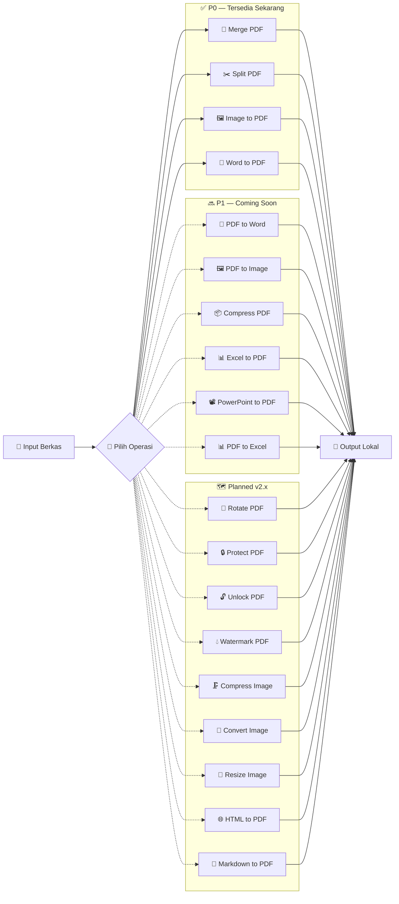

# 📑 Ringkasan Eksekutif Project: File Converter Desktop

---

### 1. Apa Itu Project Ini?

**File Converter Desktop** adalah aplikasi desktop Windows (10/11 64-bit) untuk mengelola dan mengonversi dokumen secara **100% Offline-First**.

Aplikasi ini dirancang sebagai alternatif aman pengganti konverter online (seperti iLovePDF / Smallpdf):
* **Tanpa Cloud & Tanpa Telemetri:** Dokumen tidak pernah diunggah ke internet; diproses murni oleh CPU & RAM lokal.
* **Non-Destruktif:** Berkas asli dibuka dalam mode *read-only* sehingga tidak akan pernah rusak atau terhapus.
* **Sangat Ringan & Cepat:** Berbasis **Tauri 2 + React 19 + Rust**, ukuran installer hanya **~2.0 MB** dengan kecepatan konversi dalam hitungan **milidetik** (4–32 ms).

---

### 2. Fitur Utama yang Selesai Dibangun (P0 MVP) ✅

1. **📄 Merge PDF:** Menggabungkan banyak berkas PDF secara berurutan dengan fitur *drag & drop reordering*.
2. **✂️ Split PDF:** Memotong PDF berdasarkan rentang halaman kustom (misal: `1-3, 5`) atau memisahkan seluruh halaman menjadi berkas individu (`split_all`).
3. **🖼️ Image to PDF:** Mengonversi berkas JPG, PNG, dan WEBP ke PDF dengan skala proporsional otomatis (*auto-fit & centered*) dan pengaturan margin.
4. **📝 Word to PDF:** Mengonversi dokumen `.docx` ke PDF secara lokal menggunakan *Microsoft Word COM Automation* atau *LibreOffice Headless*.
5. **⚡ Aksi Cepat Desktop:** Dukungan *drag & drop* berkas dari Windows Explorer, tombol langsung **Buka Berkas** (PDF viewer) dan **Buka di Folder**.

---

### 3. Fitur Coming Soon — P1 (Rilis Berikutnya) 🔜

Fitur-fitur berikut telah terdaftar di katalog aplikasi dan ditampilkan dengan label **"Coming Soon"** serta ikon gembok di UI:

| # | Fitur | Deskripsi | Format Input → Output |
|:---:|---|---|---|
| 1 | **📄 PDF to Word** | Mengekstrak teks dan layout PDF menjadi dokumen DOCX yang dapat diedit | `.pdf` → `.docx` |
| 2 | **🖼️ PDF to Image** | Mengonversi setiap halaman PDF menjadi gambar JPG atau PNG resolusi tinggi | `.pdf` → `.png` / `.jpg` |
| 3 | **📦 Compress PDF** | Mengoptimalkan dan memperkecil ukuran berkas PDF tanpa mengorbankan kualitas visual | `.pdf` → `.pdf` (lebih kecil) |
| 4 | **📊 Excel to PDF** | Mengonversi spreadsheet Excel dan CSV menjadi laporan PDF yang rapi | `.xlsx`, `.xls`, `.csv` → `.pdf` |
| 5 | **📽️ PowerPoint to PDF** | Mengonversi presentasi PowerPoint menjadi berkas PDF portabel | `.pptx`, `.ppt` → `.pdf` |
| 6 | **📊 PDF to Excel** | Mengekstrak tabel dari dokumen PDF menjadi spreadsheet XLSX yang dapat diedit | `.pdf` → `.xlsx` |

---

### 4. Fitur Roadmap — Planned (Versi 2.x) 🗺️

Fitur-fitur berikut telah direncanakan untuk versi mendatang dan ditampilkan dengan label **"Planned"** di UI:

#### 🔧 PDF Tools Lanjutan

| # | Fitur | Deskripsi |
|:---:|---|---|
| 1 | **🔄 Rotate PDF** | Memutar halaman individual atau seluruh dokumen PDF sebesar 90°, 180°, atau 270° |
| 2 | **🔒 Protect PDF** | Menambahkan enkripsi password dan pembatasan akses pada berkas PDF |
| 3 | **🔓 Unlock PDF** | Menghapus proteksi password dari berkas PDF (memerlukan password asli) |
| 4 | **💧 Watermark PDF** | Menambahkan watermark teks atau gambar kustom ke setiap halaman PDF |

#### 🖼️ Image Tools

| # | Fitur | Deskripsi |
|:---:|---|---|
| 5 | **🗜️ Compress Image** | Mengurangi ukuran berkas gambar sambil mempertahankan kualitas visual |
| 6 | **🔄 Convert Image** | Mengonversi gambar antar format: JPG, PNG, WEBP, BMP, dan TIFF |
| 7 | **📐 Resize Image** | Mengubah dimensi gambar ke ukuran tepat atau persentase dengan menjaga rasio aspek |

#### 📝 Document Tools Lanjutan

| # | Fitur | Deskripsi |
|:---:|---|---|
| 8 | **🌐 HTML to PDF** | Mengonversi berkas HTML lokal menjadi PDF dengan gaya CSS yang dipertahankan |
| 9 | **📝 Markdown to PDF** | Merender berkas Markdown (.md) menjadi dokumen PDF yang diformat dengan cantik |

---

### 5. Peta Visual Seluruh Fitur (Sekarang + Mendatang)

---

### 6. Rekap Eksekusi 10 Fase Pengembangan

Seluruh 10 fase pada [`02-PRD_AND_PLAYBOOK.md`](file:///d:/Konverter/02-PRD_AND_PLAYBOOK.md) telah selesai 100%:

| Fase | Nama Tahapan | Hasil Utama yang Dicapai |
|:---:|---|---|
| **0 & 1** | Bootstrap | Setup Rust stable MSVC, Tauri 2, React 19, TypeScript, dan Vite 8. |
| **2** | Frontend Foundation | Konfigurasi Tailwind CSS v4, shadcn/ui (radix-nova), dan Zustand store. |
| **3** | Technical Planning | Menyusun arsitektur sistem, batas tanggung jawab, dan IPC contract. |
| **4** | Engine PoC | Validasi 4 mesin konversi mandiri dengan berkas nyata (`poc-converters/`). |
| **5** | Application Shell | Pembuatan layout desktop responsif, sidebar navigasi, header, dan tema warna. |
| **6** | Workflow UI | Dropzone berkas, validasi format, panel opsi per-alat, dan progress bar. |
| **7** | Rust Backend | Pembuatan Tauri commands, converters (`lopdf`, `image`), dan error mapping. |
| **8** | Integration | Mengganti mock dengan IPC nyata, plugin dialog, opener, dan deteksi engine. |
| **9** | Testing & Reliability | 15 skenario pengujian otomatis lulus (uji berkas rusak, 0-byte, rentang salah). |
| **10** | Packaging & Release | Menghasilkan installer siap pakai untuk Windows (NSIS `.exe` dan `.msi`). |

---

### 7. Berkas Rilis & Artefak Siap Pakai

Paket instalasi produksi telah selesai dibuild di [`converter-desktop/src-tauri/target/release/`](file:///d:/Konverter/converter-desktop/src-tauri/target/release/):

* 📦 **Installer Setup:** [`File Converter Desktop_1.0.0_x64-setup.exe`](file:///d:/Konverter/converter-desktop/src-tauri/target/release/bundle/nsis/File%20Converter%20Desktop_1.0.0_x64-setup.exe) (**2.04 MB**)
* 📦 **Paket MSI:** [`File Converter Desktop_1.0.0_x64_en-US.msi`](file:///d:/Konverter/converter-desktop/src-tauri/target/release/bundle/msi/File%20Converter%20Desktop_1.0.0_x64_en-US.msi) (**2.89 MB**)
* 💻 **Biner Portabel:** [`converter-desktop.exe`](file:///d:/Konverter/converter-desktop/src-tauri/target/release/converter-desktop.exe) (**10.6 MB**)

---

### 8. Statistik Katalog Fitur

| Status | Jumlah | Keterangan |
|---|:---:|---|
| ✅ **Ready (P0 MVP)** | **4 fitur** | Merge PDF, Split PDF, Image to PDF, Word to PDF |
| 🔜 **Coming Soon (P1)** | **6 fitur** | PDF to Word, PDF to Image, Compress PDF, Excel to PDF, PowerPoint to PDF, PDF to Excel |
| 🗺️ **Planned (Future v2.x)** | **9 fitur** | Rotate/Protect/Unlock/Watermark PDF, Compress/Convert/Resize Image, HTML to PDF, Markdown to PDF |
| **Total Katalog** | **19 fitur** | Dari 4 kategori: PDF Tools, Document, Image, Archive |

---

### 9. Dokumentasi Terstruktur yang Disediakan

Dokumentasi project kini tersusun rapi dan berurutan:
1. [`01-PRODUCT_BRIEF.md`](file:///d:/Konverter/01-PRODUCT_BRIEF.md): Visi awal produk
2. [`02-PRD_AND_PLAYBOOK.md`](file:///d:/Konverter/02-PRD_AND_PLAYBOOK.md): PRD & alur 10 fase
3. [`03-TECHNICAL_PLANNING_GUIDE.md`](file:///d:/Konverter/03-TECHNICAL_PLANNING_GUIDE.md): Panduan perencanaan
4. [`04-TECHNICAL_PLAN.md`](file:///d:/Konverter/04-TECHNICAL_PLAN.md): Rencana arsitektur & IPC
5. [`04-TECHNICAL_PLAN_SPEC.md`](file:///d:/Konverter/04-TECHNICAL_PLAN_SPEC.md): Detail spesifikasi
6. [`05-POC_VALIDATION_REPORT.md`](file:///d:/Konverter/05-POC_VALIDATION_REPORT.md): Laporan validasi PoC
7. [`06-TEST_REPORT.md`](file:///d:/Konverter/06-TEST_REPORT.md): Laporan 15 skenario pengujian
8. [`07-RELEASE_NOTES.md`](file:///d:/Konverter/07-RELEASE_NOTES.md): Catatan rilis v1.0.0 & panduan instalasi
9. [`README.md`](file:///d:/Konverter/README.md): Halaman utama lengkap dengan banner & diagram arsitektur SVG
